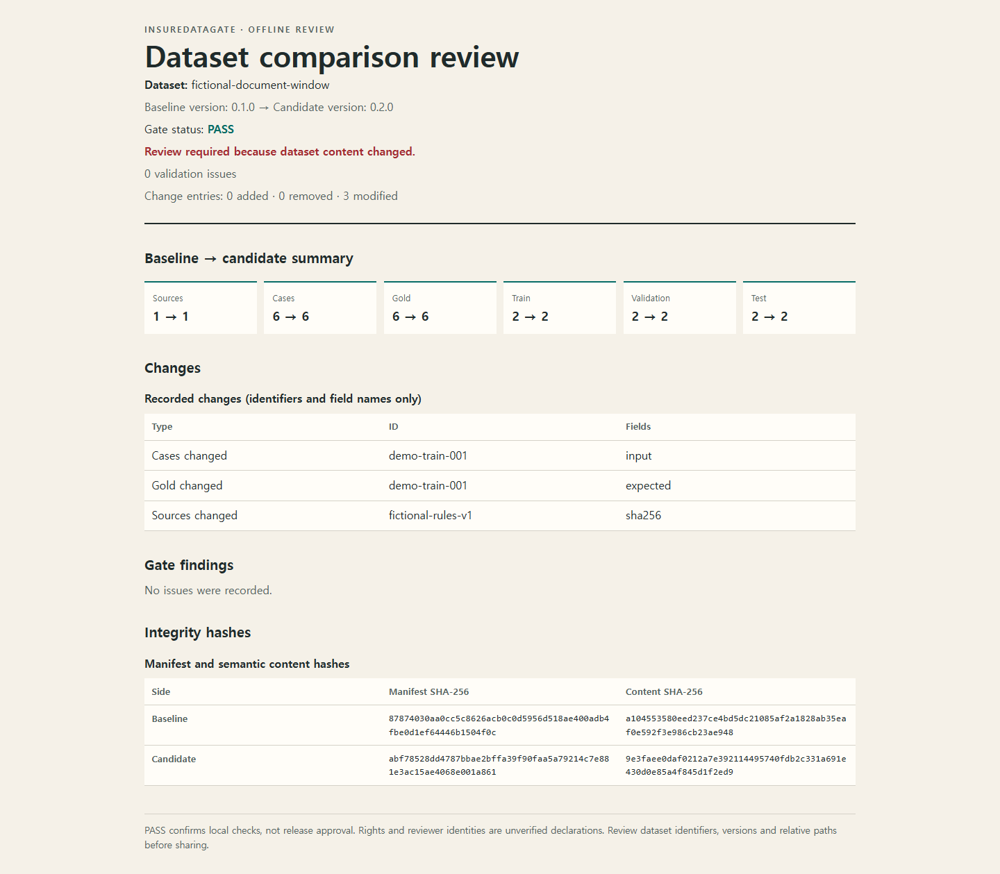
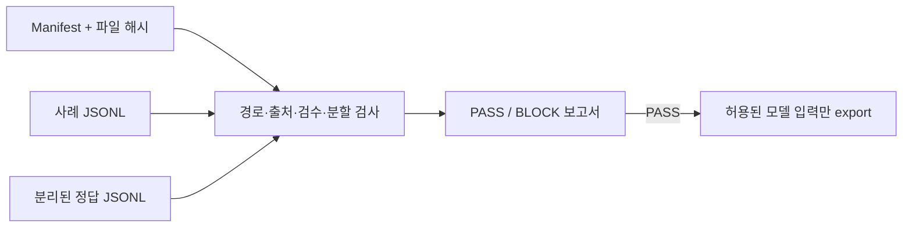

# InsureDataGate

[](https://github.com/KIMJINWOO0548/InsureDataGate/actions/workflows/ci.yml)

**Review synthetic insurance dataset releases: validation, semantic diffs and offline evidence.**

InsureDataGate checks a versioned manifest, declared source rights, file hashes, separation of cases from gold answers, review declarations, and train/validation/test isolation. Compare two validated releases, inspect identifiers and changed fields in a standalone HTML report, then export only allowlisted model inputs. The runtime uses the Python standard library with no network calls.

> 모든 예시와 신원은 허구이며 합성 데이터입니다. 실제 고객 정보나 보험금·법률 판단을 위한 도구가 아닙니다.

데이터셋을 공개하기 전에 **파일이 바뀌었는지, 검수 선언이 빠졌는지, 정답 파일과 모델 입력이 분리됐는지, 새 버전이 무엇을 바꿨는지**를 확인합니다. JSON 서식·레코드 순서·파일 위치 변경과 실제 입력·정답·출처 변경을 구분하며, 같은 버전 이름으로 내용이 달라지면 차단합니다. 보고서에는 ID·변경 필드·해시를 표시하고 사례와 정답 본문은 넣지 않습니다.

## 빠른 시작

Python 3.11 이상이 필요합니다. 실행 시 외부 의존성과 네트워크 연결은 없습니다. 소스에서 설치할 때는 빌드 도구 setuptools가 필요하며 pip가 내려받을 수 있습니다.

Windows PowerShell:

```powershell
git clone https://github.com/KIMJINWOO0548/InsureDataGate.git
cd InsureDataGate
py -3.12 -m venv .venv
.\.venv\Scripts\python.exe -m pip install .
.\.venv\Scripts\insuredatagate.exe check examples/insurance-demo/manifest.json
.\.venv\Scripts\insuredatagate.exe check examples/insurance-demo/manifest.json --json
.\.venv\Scripts\insuredatagate.exe compare examples/insurance-demo/manifest.json examples/insurance-demo-v2/manifest.json --html .\release-review.html
.\.venv\Scripts\insuredatagate.exe export-inputs examples/insurance-demo/manifest.json --output .\demo-inputs.jsonl
```

macOS / Linux:

```sh
git clone https://github.com/KIMJINWOO0548/InsureDataGate.git
cd InsureDataGate
python3 -m venv .venv
.venv/bin/python -m pip install .
.venv/bin/insuredatagate check examples/insurance-demo/manifest.json
.venv/bin/insuredatagate check examples/insurance-demo/manifest.json --json
.venv/bin/insuredatagate compare examples/insurance-demo/manifest.json examples/insurance-demo-v2/manifest.json --html ./release-review.html
.venv/bin/insuredatagate export-inputs examples/insurance-demo/manifest.json --output ./demo-inputs.jsonl
```

`check`와 `compare`는 요약을 출력하고 `--json`은 JSON 보고서를 stdout에 출력합니다. `--report NEW_JSON` 또는 `--html NEW_HTML` 중 하나로 새 파일을 만들 수 있습니다. HTML은 파일을 열면 바로 읽을 수 있으며 서버·JavaScript·외부 폰트가 없습니다. 출력 경로가 이미 존재하면 덮어쓰지 않습니다. 일반적인 write/close/interrupt 실패 때 생성한 파일을 정리합니다. `export-inputs`는 검증 성공 후 모든 참조 파일을 재확인하고 사례 ID, 입력, 출처 ID만 내보냅니다.

| 상황 | 결과 |
| --- | --- |
| 서식·레코드 순서·경로만 변경 | 내용 동일; 의미적 hash 유지 |
| 입력·정답·출처·검수 선언 변경 | ID와 변경 필드 표시; 검토 필요 |
| 내용이 바뀌었는데 버전 재사용 | BLOCK / VERSION_REUSED |
| 한쪽 데이터셋이 잘못됐거나 읽히지 않음 | BLOCK; diff 미제공, 변경 없음으로 표시하지 않음 |
| PASS 뒤 참조 파일 변경·누락 | 내보내기/비교 차단 |

예제 결과: [변경 검토 HTML](docs/examples/release-review.html), [단일 검사 HTML](docs/examples/validation-review.html). GitHub에서는 파일을 내려받아 브라우저로 열 수 있습니다. 보고서의 metadata와 상대 경로는 공유 전에 검토하세요.



[390px 모바일 화면](docs/images/release-review-mobile.png). 실제 합성 예제를 렌더링한 화면이며 모형 대시보드가 아닙니다.

설치 없이 오프라인으로 실행하려면 Windows에서 `$env:PYTHONPATH = "$PWD\src"`를 지정한 뒤 `py -3.12 -m insuredatagate check examples/insurance-demo/manifest.json`을 실행하세요. Unix에서는 `PYTHONPATH=src python3 -m insuredatagate check examples/insurance-demo/manifest.json`입니다.



## 종료 코드

- `0`: 검사 또는 내보내기 성공
- `1`: 데이터가 차단됨 (예: 잘못된 manifest, 해시 불일치, split 누출, 미승인 선언)
- `2`: 명령행 또는 출력 파일 I/O 오류

오류 진단은 입력 사례·정답 내용을 출력하지 않습니다. PASS는 로컬 선언과 파일 일관성 검사를 통과했다는 뜻이며 독립 인증이나 법률 검토가 아닙니다.

## 데모 파일

[데모 manifest](examples/insurance-demo/manifest.json)는 [출처 규칙](examples/insurance-demo/sources/rules.txt), [사례](examples/insurance-demo/cases.jsonl), [분리된 정답](examples/insurance-demo/gold.jsonl)을 SHA-256으로 고정합니다. 여섯 개의 허구 사례가 train, validation, test에 나뉘어 있습니다. [별도 v2 예제](examples/insurance-demo-v2/manifest.json)는 입력 1건·정답 1건·출처 파일의 명시적 합성 수정본이며 원래 데이터는 보존합니다. 형식 설명은 [docs/FORMAT.md](docs/FORMAT.md), 기존 계약은 [docs/CONTRACT.md](docs/CONTRACT.md), 0.2 확장은 [QUALITY_UPGRADE.md](docs/QUALITY_UPGRADE.md)를 참고하세요.

## 범위와 한계

이 도구는 오프라인 데이터셋 검사기입니다. 네트워크로 출처를 조회하지 않고 라이선스, 승인자, 검토자 신원을 인증하지 않습니다. 의미가 비슷한 문장이나 선언되지 않은 그룹 관계에 의한 누출, 자연어 입력 안에 숨은 정답을 판별하지 못합니다. 보험 인수·지급·청구 판단을 하지 않으며 운영 승인, 법률 자문, 규제 준수 인증을 제공하지 않습니다.

## 개발과 검증

```sh
python -m unittest discover -s tests -v
```

Windows x64/Python 3.12에서 선택적 화면 검증을 재현하려면 설치된 Chrome과 별도 개발 환경이 필요합니다. 이 의존성은 CLI 실행·wheel에 포함되지 않습니다.

```powershell
py -3.12 -m venv .runtime/browser-env
.\.runtime\browser-env\Scripts\python.exe -m pip install --require-hashes -r requirements-browser.lock
.\.runtime\browser-env\Scripts\python.exe scripts/check_report_browser.py
```

배포물 검사는 별도 환경에서 `requirements-build.lock`을 `pip install --require-hashes -r requirements-build.lock`으로 설치한 뒤 `python scripts/check_distribution.py`로 실행합니다. CI에서는 선택적 Playwright 의존성도 hash로 고정하고 고립된 Chromium으로 같은 화면 회귀를 실행합니다. UI 출처·라이선스·채택 범위는 [UI_REFERENCES.md](docs/UI_REFERENCES.md)에 기록했습니다.

[요구사항·인수 기준](docs/REQUIREMENTS.md), [0.1 구현 계획](docs/superpowers/plans/2026-11-01-insuredatagate.md), [0.2 구현 계획](docs/superpowers/plans/2026-11-01-release-review.md), [실제 검증 기록](VALIDATION.md), [도구 사용 기록](docs/TOOLING.md)을 공개합니다. CaseProof에서 다루는 출처·정답 분리와 증거 원칙을 참고해 독립적으로 작성했으며 기존 API나 DB에 의존하지 않습니다. 코드와 예제는 [Apache-2.0](LICENSE)으로 제공합니다.
