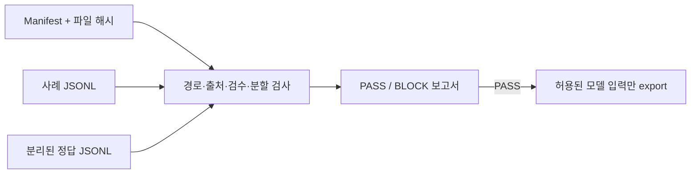

# InsureDataGate

[](https://github.com/KIMJINWOO0548/InsureDataGate/actions/workflows/ci.yml)

**An offline, standard-library-only gate for synthetic insurance AI evaluation datasets.**

InsureDataGate checks a versioned manifest, declared source rights, file hashes, separation of cases from gold answers, review declarations, and train/validation/test isolation. It exports only allowlisted model inputs after the complete local check passes.

> 모든 예시와 신원은 허구이며 합성 데이터입니다. 실제 고객 정보나 보험금·법률 판단을 위한 도구가 아닙니다.

## 빠른 시작

Python 3.11 이상이 필요합니다. 실행 시 외부 의존성과 네트워크 연결은 없습니다. 소스에서 설치할 때는 빌드 도구 setuptools가 필요하며 pip가 내려받을 수 있습니다.

Windows PowerShell:

```powershell
git clone https://github.com/KIMJINWOO0548/InsureDataGate.git
cd InsureDataGate
py -3.12 -m venv .venv
.\.venv\Scripts\python.exe -m pip install .
.\.venv\Scripts\insuredatagate.exe check examples/insurance-demo/manifest.json
.\.venv\Scripts\insuredatagate.exe check examples/insurance-demo/manifest.json --json
.\.venv\Scripts\insuredatagate.exe export-inputs examples/insurance-demo/manifest.json --output .\demo-inputs.jsonl
```

macOS / Linux:

```sh
git clone https://github.com/KIMJINWOO0548/InsureDataGate.git
cd InsureDataGate
python3 -m venv .venv
.venv/bin/python -m pip install .
.venv/bin/insuredatagate check examples/insurance-demo/manifest.json
.venv/bin/insuredatagate check examples/insurance-demo/manifest.json --json
.venv/bin/insuredatagate export-inputs examples/insurance-demo/manifest.json --output ./demo-inputs.jsonl
```

`check`는 기본적으로 요약을 출력하고 `--json`은 JSON 리포트를 stdout에 출력합니다. `--report NEW_PATH`를 지정하면 새 리포트 파일도 만들 수 있습니다. 출력 경로가 이미 존재하면 덮어쓰지 않습니다. `export-inputs`는 검증 성공 시 사례 ID, 입력, 출처 ID만 내보내며 정답이나 검토 정보를 포함하지 않습니다.

설치 없이 오프라인으로 실행하려면 Windows에서 `$env:PYTHONPATH = "$PWD\src"`를 지정한 뒤 `py -3.12 -m insuredatagate check examples/insurance-demo/manifest.json`을 실행하세요. Unix에서는 `PYTHONPATH=src python3 -m insuredatagate check examples/insurance-demo/manifest.json`입니다.



## 종료 코드

- `0`: 검사 또는 내보내기 성공
- `1`: 데이터가 차단됨 (예: 잘못된 manifest, 해시 불일치, split 누출, 미승인 선언)
- `2`: 명령행 또는 출력 파일 I/O 오류

오류 진단은 입력 사례·정답 내용을 출력하지 않습니다. PASS는 로컬 선언과 파일 일관성 검사를 통과했다는 뜻이며 독립 인증이나 법률 검토가 아닙니다.

## 데모 파일

[데모 manifest](examples/insurance-demo/manifest.json)는 [출처 규칙](examples/insurance-demo/sources/rules.txt), [사례](examples/insurance-demo/cases.jsonl), [분리된 정답](examples/insurance-demo/gold.jsonl)을 SHA-256으로 고정합니다. 여섯 개의 허구 사례가 train, validation, test에 나뉘어 있습니다. 형식 설명은 [docs/FORMAT.md](docs/FORMAT.md), 전체 계약은 [docs/CONTRACT.md](docs/CONTRACT.md)를 참고하세요.

## 범위와 한계

이 도구는 오프라인 데이터셋 검사기입니다. 네트워크로 출처를 조회하지 않고 라이선스, 승인자, 검토자 신원을 인증하지 않습니다. 의미가 비슷한 문장이나 선언되지 않은 그룹 관계에 의한 누출, 자연어 입력 안에 숨은 정답을 판별하지 못합니다. 보험 인수·지급·청구 판단을 하지 않으며 운영 승인, 법률 자문, 규제 준수 인증을 제공하지 않습니다.

## 개발과 검증

```sh
python -m unittest discover -s tests -v
```

[요구사항·인수 기준](docs/REQUIREMENTS.md), [구현 계획](docs/superpowers/plans/2026-11-01-insuredatagate.md), [실제 검증 기록](VALIDATION.md), [도구 사용 기록](docs/TOOLING.md)을 공개합니다. CaseProof에서 다루는 출처·정답 분리와 증거 원칙을 참고해 독립적으로 작성했으며 기존 API나 DB에 의존하지 않습니다. 코드와 예제는 [Apache-2.0](LICENSE)으로 제공합니다.
